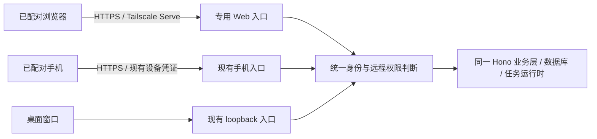

# 配对式远程 Web 终端调研（ISSUE-331）

状态：2026-11-05 已按用户确认的独立设备模型实施首版，完成本地回归，待部署环境验收。下文保留调研依据；实施差异与验证记录见文末。未修改用户的 Tailscale、代理或主机网络配置。

## 已确认的产品定位

浏览器与手机都是需要配对的远程终端。Actovia 所在电脑是主机，保存聊天、密钥、记忆、工作区并执行模型、CLI 和自动化任务；手机和浏览器连接同一台主机。

因此应共享设备登记、配对、撤销和远程权限模型，不新增 Web 用户账号体系，也不把浏览器默认降级成只读页面。同一个远程操作不应仅因来自浏览器就被额外禁止。UI 可以复用桌面 renderer，客户端的权限地位仍是“已配对远程终端”。

“屏蔽 Electron bridge”需要区分两件事：宿主原生 UI 能力隐藏；已有 HTTP 远程能力正常提供。远程发送任务、回答 PM、停止任务、处理审批，不应因为没有 IPC 而一起被删掉。

主机进程必须持续运行。此次范围是桌面客户端附带的 Web 终端，不包含无 GUI daemon、容器部署或第二份数据库。

## 建议的架构

Web 入口提供打包后的静态页面和同源 `/api/v1`，由主机进程管理生命周期。建议独立监听 loopback，由 Tailscale Serve 提供 tailnet 内的 HTTPS；端口在实现阶段确定，不占用现有 60223/63129。

复用业务 routers/服务，而不是把任意 Web 请求无鉴权转发到 60223。浏览器凭证验证后仍需保留 `deviceId` 和远程身份，不能把请求改装成桌面 presence，也不能靠 `127.0.0.1` 判断已授权。

Tailscale 解决连通性和 TLS，不取代 Actovia 的配对。即使访问者属于同一个 tailnet，未配对也只能看到连接页，不能读取聊天或调用业务 API。[Serve 官方说明](https://tailscale.com/docs/features/tailscale-serve)

## 当前实现可以复用什么

| 现有能力         | 源码                                                    | Web 的复用方式                                                           |
| ---------------- | ------------------------------------------------------- | ------------------------------------------------------------------------ |
| 一次性配对窗口   | `src/main/lib/lan/pairing.ts`                           | 复用两分钟、单次使用、最多五次错误尝试的规则。保留手机协议兼容。         |
| 已配对设备       | `src/main/lib/lan/devices.ts`、`db/device-queries.ts`   | 复用设备 ID、名称、最近使用、撤销；增加浏览器类型/凭证关联，不新增账号。 |
| 远程设备身份     | `server/middlewares/auth-gate.ts`                       | 手机 Bearer、浏览器凭证分别验证，收敛为同一远程 principal。              |
| 远程审批         | `server/middlewares/presence-gate.ts`、`routes/chat.ts` | 已配对终端可按共同权限处理审批。浏览器不取得 `x-actovia-presence`。      |
| 主机锁状态       | `server/middlewares/lock-gate.ts`、`routes/lock.ts`     | 复用 App Lock 语义；浏览器需自己的端侧解锁方式。                         |
| 远程限制         | `server/middlewares/desktop-only.ts`、`routes/host.ts`  | 手机不能做的本机专属操作，浏览器也不能做；直调 API 同样拒绝。            |
| 聊天、群组、计划 | `server/routes/chat.ts`、`philharmonic*.ts`             | 复用数据与任务，不额外启动一套 Agent/PM。                                |

现有手机配对链接是 `actovia://pair?...`，带地址、63129 端口、一次性码和自签名证书指纹。普通浏览器不能照搬原生 App 的证书 pinning；Web 需要可信 HTTPS 的连接页和配对入口，不能建议用户忽略证书错误。

设备的权限与凭证载体要分开：同级权限不要求 Cookie 与手机 Bearer 互相通用。应绑定凭证适用的 transport；新增 Web 设备也不能让 `hasDevices()` 无条件把手机 LAN listener 拉起来。

## 配对、记住终端和解锁

建议由 Settings → Devices 统一管理手机和浏览器，网页访问开关也在这里，默认关闭。列表显示终端类型、用户命名、最近连接时间以及 Revoke。不是每次访问都要求有人回到主机旁批准。

1. 在主机开启 Web access，配置并展示私有 HTTPS URL。公开的连接页可打开，业务数据必须在配对之后访问。
2. 在现有配对窗口机制下为浏览器登记一个终端。连接 URL 不长期携带凭证；优先手动输入/粘贴一次性配对码。若后续支持链接携码，必须处理日志、历史、Referer 和单次兑换。
3. 浏览器保留终端绑定；活跃会话映射到该 `deviceId`。Cookie 建议使用 `__Host-`、Secure、HttpOnly、SameSite=Strict、Path=/，不设 Domain；服务端保存可撤销的哈希会话标识。不要把长期手机 Bearer 放进 localStorage。
4. 终端进入锁定状态后，应能在远程自行解锁再继续工作。建议 WebAuthn 用户验证对应手机的 Face ID/系统验证；凭证关联在现有设备上，不变成另一套账号登录。[WebAuthn](https://developer.mozilla.org/en-US/docs/Web/API/Web_Authentication_API)、[Cookie 属性](https://developer.mozilla.org/en-US/docs/Web/HTTP/Reference/Headers/Set-Cookie)
5. 断线/主机重启后保留配对关系；会话过期需要端侧再次验证，不必重新配对。明确空闲与绝对过期，不把关闭标签页当作唯一失效条件。Cookie 清除、终端被撤销等情况再回到配对流程。

这里的“浏览器终端”是登记的逻辑终端/浏览器配置档，不是靠 User-Agent 或 Tailscale 用户名推断的物理设备。Passkey 可能跨设备同步，不能把它宣称为不可迁移的硬件标识。

**解锁不能直接照搬手机接口的信任前提。** 当前 iOS 的连接凭证由 Keychain 和用户验证释放；`POST /api/v1/lock/unlock` 信任已配对 token，不在服务端重新检查 PIN。浏览器 Cookie 自动随请求发送，没有同样的 Keychain 解锁步骤。Web 应先建立经用户验证的活跃终端会话，才能获得相同远程能力；不能仅因为 Cookie 存在就把主机解锁。WebAuthn 不可用时的 PIN/恢复方案需要审阅后确定，不能返回假成功，也不要求每次去点击主机窗口。

本地桌面 presence、已配对远程身份、模型/CLI 自己发起的本机请求仍是不同身份。手机和浏览器同级，不代表 Agent 可以冒充任意终端批准自己。

## Electron bridge 与功能边界

| 功能                                                 | 浏览器终端行为                                 | 主要适配点                                                                                                        |
| ---------------------------------------------------- | ---------------------------------------------- | ----------------------------------------------------------------------------------------------------------------- |
| Chat、历史、搜索、引用、Markdown                     | 支持正常交互                                   | 同源 API、认证、锁状态、流式结果与重连。                                                                          |
| Philharmonic、Scheduled、任务审批                    | 按已配对手机同级权限支持                       | PM/CLI 都在主机运行；发送、回答、Stop、审批走远程 API。不得只保留监看。                                           |
| Library、文件与附件                                  | 列表、文本/Markdown 预览、浏览器上传与安全下载 | 使用已验证 workspace/media 路由；不能把客户端文件选择器当成主机目录选择器。                                       |
| HTML/JS Artifact 执行                                | 单独完成浏览器沙箱隔离后支持                   | 现有 `actovia-artifact:` 和手机 WKWebView scheme handler 不能直接移植到浏览器 iframe。首版可显示源文件/静态预览。 |
| 模型、MCP、Skills、Workforce 等设置                  | 按远程授权与功能适配逐项开放                   | 已有密钥掩码继续保持；本机 CLI 路径、项目目录等受保护项维持本机权限。不是整页一概放开或禁用。                     |
| 主题、界面语言、快捷键                               | 浏览器 UI 正常工作                             | next-themes/i18n/页面快捷键保留；不调用 nativeTheme、原生菜单和全局热键。Auto locale 用浏览器环境。               |
| 窗口置前、原生全屏、菜单栏、托盘、开机启动、安装更新 | 隐藏宿主专属按钮                               | 页面全屏、浏览器搜索等是客户端功能，不是 Electron IPC。                                                           |
| Finder/Terminal、选择或打开主机目录                  | 与手机一样拒绝本机专属操作                     | 现有 `desktopOnly`、projects/agents/host 路由必须在 API 层保持限制。                                              |
| 主机 App Lock                                        | 配对后的端侧验证与解锁流程                     | 不模拟 Electron Touch ID；不把浏览器鼠标活动直接当成本机 presence。                                               |
| 语音输入、图片/相机上传                              | 使用浏览器所在设备                             | 现有录音已用 `getUserMedia` / `MediaRecorder`，需 HTTPS、权限及浏览器兼容检查。                                   |
| Computer Use / Browser Use 工具                      | 属于主机执行能力，沿用任务和审批规则           | 没有 Electron bridge 不等于不能调用服务端工具；执行的也不是访客电脑的桌面。                                       |
| Maps 地图卡                                          | 需要单独适配或明确降级                         | 当前 Google Maps JS key 只由 IPC 交给主窗口，不应随手新增 HTTP 接口吐出同一个 key。                               |
| Health                                               | 首版不承诺手机 Health 等价页面                 | HealthKit 数据在手机；当前服务器 Health API 无状态、不存报告，不能宣称已有可复用的“本机报告库”。                  |
| 系统信息、原生日志目录、重启/退出主机                | 不把宿主控制面扩展给 Web                       | 与手机同级；浏览器退出只锁定/退出该终端，不退出主机进程。                                                         |

动态代码必须与带授权的应用页面隔离。仅换 HTTP 路径或端口不足以隔离 Cookie；可研究独立无凭证 origin 或 opaque sandbox + 严格 CSP/消息通道。现有 `/api/v1/artifacts/sandbox/*` 虽可提供沙箱静态资源，当前前提是原生 scheme 和 origin gate，不能把它直接改成浏览器同源的可执行内容入口。

浏览器录音采集的是访客设备；主机侧自动化控制的是主机。两者在 UI 中应能明确区分。[浏览器媒体权限与 HTTPS](https://developer.mozilla.org/en-US/docs/Web/API/MediaDevices/getUserMedia)

## 必须先改的代码接缝

### 1. 不依赖 preload 的启动链

`src/renderer/main.tsx` 启动时就安装原生菜单、Quick Chat bridge；`AppRoot` 总是调用 `useLock()`，后者进入 `lib/lock-ipc.ts`。`NativeThemeBridge` 也无条件调用原生 IPC。仅仅隐藏 Settings 按钮仍会在首页启动时失败。

建议抽取共同 App UI 与 Desktop/Web 两个启动适配器。能力接口区分 native window、client files、authenticated remote actions；不要在 window 上放一个假 `ipcRenderer`。

直接引用 `window.electron` / `window.api` 的文件有 12 个（含注释命中，不能把检索行数当作全部调用数）。除此之外必须追踪 `lib/ipc.ts`、`lock-ipc.ts`、`attachment-actions.ts` 的调用方，以及全局副作用：

- 原生入口：`main.tsx`、`lib/menu-bridge.ts`、`lib/quick-chat-bridge.ts`。
- 锁与主题：`hooks/use-lock.ts`、`lib/lock-ipc.ts`、`components/app/theme-provider.tsx`。
- 语言：`lib/i18n.ts`、`components/app/i18n-provider.tsx`；后者已有 bridge 判断，Auto 启动值仍需浏览器来源。
- 文件/地图：`lib/attachment-actions.ts`、`lib/workspace-files.ts`、`lib/maps-key.ts`。
- 本机诊断：Settings 的 `system-info.tsx`、`logger.tsx`、`chat-audit.tsx`。

### 2. 所有请求与静态资源使用对应入口

`packages/shared/src/constants/systems.ts` 固定 `BASE_URL = http://localhost:60223`，shared fetcher 拼接它。远程浏览器的 localhost 指向访客自己的机器。

不仅要改 shared fetcher，还要覆盖直接使用 BASE_URL 的 Chat stream、群组 SSE、LCM SSE、Deep Research SSE、generated-image、remote-image、地图资源与日志请求。`index.html` 的 connect-src、Artifact frame-src 也要有 Web 版本。

现有路由是 createHashRouter，可以先复用 hash URL，避免额外引入服务端 history fallback。生产环境应打包 Web assets，不能依赖 Vite dev server。

### 3. 从网络 listener 判断，迁移到明确身份判断

当前 `ListenerKind` 只有 loopback/lan；下面代码不能原样套一个 `web` 值进去：

| 代码                                    | 当前判断                                | 新模型要求                                            |
| --------------------------------------- | --------------------------------------- | ----------------------------------------------------- |
| `middlewares/auth-gate.ts`              | loopback 直接放行；LAN 验 Bearer        | Web 验自己的凭证，并生成同级的远程 device principal。 |
| `middlewares/presence-gate.ts`          | 已通过鉴权的 LAN 可进行远程交互         | 明确允许“已配对且解锁的远程终端”，不伪造桌面 token。  |
| `middlewares/desktop-only.ts`           | 不是 LAN 就允许                         | 改为明确的本机身份；未知/新增类型不能默认允许。       |
| `routes/host.ts`、`lock.ts` 的 cli-pass | 仅拦 LAN                                | Web 也不能得到主机生命周期控制或 CLI 本机 pass。      |
| `routes/settings.ts`                    | 非 LAN 且持有 presence 才可改本机敏感项 | 保持明确本机权限，手机/Web 都不凭传输类型扩权。       |
| `middlewares/origin-gate.ts`            | 接受无 Origin 或特定 devOrigin          | Web 限定配置的 Host/Origin，并与现有原生入口隔离。    |

同级权限建议以统一 `ClientPrincipal` / capabilities 判断表达；“从哪个 socket 进来”仍用于传输约束，但不再暗中等于“是否是用户本人”。配对管理本身继续只由主机开启；远程终端只可忘记/撤销自己，不能配对或撤销其他终端。

### 4. 撤销、锁定和流式连接必须一起定义

当前 `lan/devices.ts` 明确保证撤销在下一次请求生效。群组 SSE 在建立连接时鉴权，连接注册没有 deviceId 绑定；本轮未运行动态撤销试验，不能把“所有既有 SSE 立即断开”算作现成功能。

实现时要以 deviceId 管理 Web 活跃会话/连接。撤销、锁定、会话过期后停止向该终端发数据，后续请求拒绝；但不要把浏览器刷新误判为用户 Stop，也不要重放发送任务。Philharmonic 已有独立 PM registry；Chat 请求与流的生命周期还需单独验证。

同源 Cookie 适合原生 EventSource，避免把 Bearer 塞进 SSE URL。反向代理的 flush、心跳、断线回读、后台标签页/睡眠恢复都必须在真实浏览器中验证。[EventSource](https://developer.mozilla.org/en-US/docs/Web/API/EventSource)

## 接入方式比较

| 方式                            | 适用性                                                    | 建议                                                           |
| ------------------------------- | --------------------------------------------------------- | -------------------------------------------------------------- |
| Tailscale Serve → 专用 Web 入口 | 私有 tailnet + HTTPS；浏览器设备需有到 tailnet 的网络路径 | 首选。Actovia 配对仍必须保留。                                 |
| 自管 VPN + HTTPS 反向代理       | 已有 homelab 网络/证书体系的用户                          | 保留代理兼容性；不在首版内置一套 VPN。                         |
| Cloudflare Tunnel + Access      | 不方便安装 VPN 客户端的设备                               | 后续可支持；需要域名和 Access/源站鉴权配置，仍要配对 Actovia。 |
| SSH 本地端口转发                | 维护和调试入口                                            | 可以连到未来的受鉴权 Web 入口；不直接转发当前可信的 60223。    |
| Tailscale Funnel / 裸公网入口   | 公网暴露，与默认私有访问目标不同                          | 不作为首版默认；不能只启 Tunnel/Funnel 就省略配对和鉴权。      |

[Serve 与 CLI](https://tailscale.com/docs/reference/tailscale-cli/serve)、[Funnel](https://tailscale.com/docs/features/tailscale-funnel)、[Cloudflare Access + Tunnel](https://developers.cloudflare.com/cloudflare-one/access-controls/applications/http-apps/self-hosted-public-app/)、[OpenSSH local forwarding](https://man.openbsd.org/ssh.1)

Tailscale 选择使用者现有安装，不后台静默登录、修改 tailnet policy 或启用 Funnel。不能覆盖已有 Serve 配置；若其根路径/HTTPS 端口已有用途，先显示冲突并由用户选入口。Serve 身份 headers 是可选附加信号，不等于设备配对；tagged devices 也不一定携带用户身份。

Web 写操作除 Cookie 外还要校验 Origin/CSRF，登录/配对也不能例外。Tailscale 与自管代理只改变传输路径；未配对、被撤销或未解锁的终端不能通过任何入口绕过业务授权。

## 推荐实施顺序与验收

1. **统一终端模型与无 bridge 启动**：保留现有手机兼容性，抽离 Desktop/Web 入口、请求 origin 和能力接口。无 `window.electron` 时启动所有首版页面，不发出未处理 IPC 错误。
2. **配对和终端生命周期**：同一 Devices 列表登记 Web；可信 HTTPS、短期单次配对、持久绑定、端侧解锁、会话/CSRF、撤销自己与主机统一撤销。浏览器关闭访问不影响手机 pairing。
3. **远程功能同级**：Chat/Philharmonic/Scheduled 的读写、问答、审批、Stop 与手机共享授权。主机路径选择、Terminal、更新、host/cli-pass 等仍拒绝远程直调。原生手机现有测试不得回退。
4. **文件与资源**：浏览器选本机文件上传、主机产物安全下载、Markdown/图片资源同源鉴权；不越过 workspace 的路径/符号链接检查。HTML Artifact 单独完成隔离验收后接入。
5. **Settings 与分发**：默认关闭、明确的连接 URL/状态/终端列表，Web assets 随生产包交付；关闭后停 listener、使活跃 Web 会话失效，保留手机能力及明确的配对生命周期。
6. **代理与浏览器验证**：Serve 真实 HTTPS、请求流式传输、刷新不重复执行、锁定/过期/撤销切断数据、CSRF/伪造身份 header/跨源请求被拒绝、不支持的 native 按钮不可见且 API 不放行。

## 还需审阅的具体选择

- 采用“与手机同级的配对远程终端 + 默认 Tailscale Serve”的主方向；同级定位已经由用户确认。
- 浏览器端侧解锁优先 WebAuthn；不支持的浏览器是否提供经过限流的 PIN/恢复流程。这里是交互和实现选择，不是新增用户账号体系。
- HTML Artifact 隔离、Health 页面不作为第一阶段前置承诺；首批以可实际工作的 Chat 与 Philharmonic 终端为验收目标。

## 首版实施记录

- 专用 loopback 端口为 `63130`，配置入口是 Settings → Devices → Browser terminals，默认关闭。HTTPS 反向代理由用户配置，不改动现有 `60223` / `63129`。
- 每个配对的浏览器配置文件新增独立 `paired_device` 记录，和手机同列表、可分别撤销。刷新、重新验证只复用原记录。设备 Cookie 清除后再次配对会新增设备，旧记录可由主机撤销。
- SimpleWebAuthn 负责创建与验证通行密钥，要求用户验证。首版不提供 PIN 降级；设备绑定保存 90 天，会话空闲 30 分钟 / 绝对 12 小时过期，主机重启后需重新验证。浏览器会话 Cookie 不作为任务或设备身份的唯一持久存储。
- 取消或替换配对邀请、App Lock、撤销和关闭 Web access 会使对应待验证挑战失效；已有 Web SSE 在锁定、撤销、到期后关闭。浏览器只可锁定/忘记自己，不能管理别的设备。
- Chat / Philharmonic / Scheduled 复用现有 renderer、API 和远程审批身份。无 bridge 启动经过浏览器验证；原生菜单、更新、锁屏、主机路径选择和 Terminal 入口已隔离。
- HTML Artifact 首版只展示和下载源码，禁止同源执行；HealthKit 数据和 Maps JS 密钥不新增 HTTP 暴露。无 GUI daemon、PIN 恢复与独立 Artifact Web sandbox 不在本次范围。
- 单元测试覆盖 Origin/CSRF、无会话拒绝、Cookie、挑战单次/取消/过期、SSE 撤销竞争、独立设备、旧手机迁移和静态文件边界。独立内存测试主机上的 Chromium 虚拟验证器覆盖实际 WebAuthn 配对/解锁、多设备撤销、空闲过期、主机锁定及窄屏；不使用用户数据库或凭据。
- 真实 Tailscale HTTPS / Safari / 硬件通行密钥仍需部署环境验收，不能把虚拟验证器测试写成已完成的实际代理或硬件测试。

本地验证：`bun run test`（538 个文件、4,848 项）、独立浏览器 WebAuthn E2E（7 项）、原生 Settings/Lock/Runtime 与浏览器配对 E2E（10 项）通过；格式、lint、全项目类型检查和 i18n parity 通过，macOS arm64 生产包构建通过。另检查发布包包含 Web entry 与完整 WebAuthn 运行时依赖、排除测试 harness，并从归档提取依赖在独立目录运行验证。真实 Tailscale/Safari/硬件验证未冒充本地已测项目。

## 2026-11-06 开发启动验收修复

用户现场验收时，Tailscale Serve 已转发到 63130；实际 HTTPS 请求到达 Actovia，但网页资源缺失导致 503。原因是 Forge 的 VitePlugin 在 preStart 删除整个 `.vite`，仅手动执行一次 `build:web` 不能保证下次开发启动仍有网页入口。

新增 `WebEntryPlugin`，在 VitePlugin 清理之后、Electron 启动之前构建静态 Web entry；增加实际 Vite 构建的冷启动回归与插件顺序测试。资源根目录改为逐请求解析，构建恢复后无需重新启停网页服务。已为当前运行版本补齐编译资源，验证用户配置的实际 Tailscale HTTPS URL 返回 200、11 个入口依赖资源均可读取，未配对状态仍为 paired=false / unlocked=false。未修改 Tailscale Serve 或网络配置；真实硬件通行密钥流程仍待用户验收。
